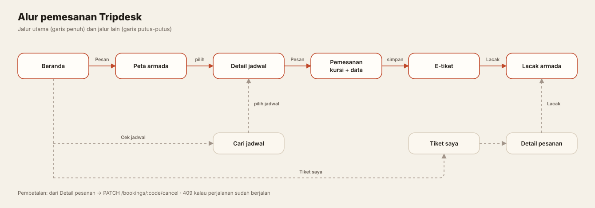
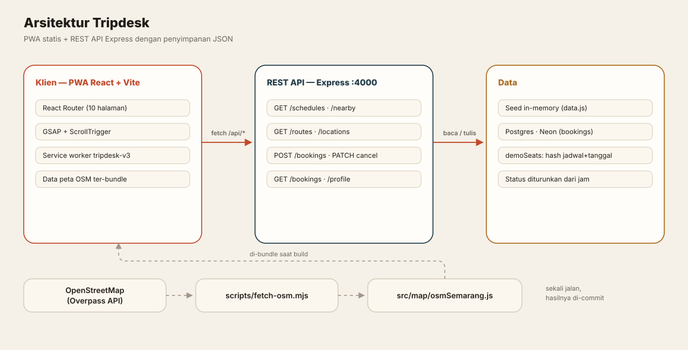

# Tripdesk

Aplikasi pemesanan tiket **travel shuttle antarkota** — pencarian rute, jadwal, pilih kursi, e-tiket, dan pembatalan.

Status: **skeleton berjalan** (API + UI + alur pemesanan end-to-end), sudah diunggah ke [GitHub](https://github.com/farasfauzan/TripDESK), belum terdeploy.

📘 Dokumentasi lengkap: [docs/APLIKASI.md](docs/APLIKASI.md) — arsitektur, API, model data, peta, PWA.


## Stack

| Bagian | Teknologi |
| --- | --- |
| Frontend | React 18, React Router 6, Vite 6, GSAP 3 + ScrollTrigger (`@gsap/react`), CSS mobile-first, PWA (manifest + service worker) |
| Backend | Node.js, Express 4, REST API |
| Data | Seed in-memory (`server/src/data.js`) + [Neon](https://neon.tech) Lakebase Postgres (tabel `bookings`) untuk pesanan |

## Alur & arsitektur





Diagram digambar manual di draw.io — sumbernya [docs/diagram.drawio](docs/diagram.drawio) (buka di [app.diagrams.net](https://app.diagrams.net)). Kalau diagram diubah, ekspor ulang SVG-nya dari draw.io (File → Export as → SVG) supaya README ikut berubah.

## Struktur

```
TripDESK/
├── app/                  # PWA React + Vite
│   ├── public/           # manifest, ikon PNG/SVG, service worker
│   └── src/
│       ├── home/         # beranda (peta kartu, layanan, rute favorit)
│       ├── armada/       # peta armada + sheet pesan travel
│       ├── map/          # mesin peta: ZoomMap, TravelMap, data OSM/kota
│       ├── tracking/     # lacak armada: halaman, peta, trackingView
│       ├── search/       # cari jadwal
│       ├── schedule/     # detail jadwal + ScheduleCard
│       ├── checkout/     # pemesanan + pilih kursi
│       ├── orders/       # tiket saya, detail pesanan, unduh tiket PNG
│       ├── profile/      # profil
│       ├── about/        # tentang aplikasi
│       ├── shared/       # api, utils, animations, weather, Icons,
│       │                 # State, BottomNav, NotFound
│       ├── App.jsx       # routing
│       ├── main.jsx      # bootstrap + PWA
│       └── styles.css    # design system kecil + layout mobile
├── server/               # REST API Express
│   ├── db/
│   │   └── schema.sql    # skema tabel bookings (PostgreSQL)
│   ├── scripts/
│   │   ├── migrate.mjs   # jalankan skema ke Neon (koneksi direct)
│   │   └── test-api.mjs  # smoke test alur pemesanan ke Neon
│   └── src/
│       ├── data.js       # seed kota, rute, armada, jadwal, profil
│       ├── db.js         # pool node-postgres ke Neon
│       ├── store.js      # query pesanan + ketersediaan kursi
│       ├── dates.js      # util tanggal ISO
│       ├── app.js        # setup express
│       └── routes/       # catalog.js, bookings.js, profile.js
└── docs/
    ├── APLIKASI.md       # dokumentasi teknis: arsitektur, API, peta, PWA
    ├── diagram.drawio    # sumber diagram (alur + arsitektur)
    ├── diagram-alur.svg
    ├── diagram-arsitektur.svg
    └── RENCANA.md        # rencana, mapping requirement, backlog
```

## Menjalankan

Butuh Node.js 20+.

```bash
# terminal 1 — API
cd server
npm install
npm run dev          # http://localhost:4000/api

# terminal 2 — PWA
cd app
npm install
npm run dev          # http://localhost:5173
```

Vite mem-proxy `/api` ke `localhost:4000`, jadi frontend tidak butuh konfigurasi tambahan saat development.

Build produksi:

```bash
cd app
npm run build         # hasil di app/dist
npm run preview       # cek hasil build
```

Saat deploy, set `VITE_API_URL` ke URL API publik (contoh `https://tripdesk-api.onrender.com/api`) lalu build ulang. API mengaktifkan CORS untuk semua origin pada demo ini.

## Endpoint API

| Method | Endpoint | Keterangan |
| --- | --- | --- |
| GET | `/api/health` | Cek status API |
| GET | `/api/locations` | Daftar kota asal/tujuan |
| GET | `/api/pickup-points` | Titik jemput per kota asal, query `origin` |
| GET | `/api/routes` | Rute, filter `origin`, `destination`, `date` |
| GET | `/api/routes/:id` | Detail rute + jadwalnya |
| GET | `/api/schedules` | Daftar armada, filter `origin`, `destination`, `date`, `pickupPointId` (menambah `pickupTime`) |
| GET | `/api/nearby` | Armada kosong dalam radius 5 km, filter `origin`, `destination`, `date`, `pickupPointId` |
| GET | `/api/schedules/:id` | Detail jadwal + peta kursi + jam tiap titik jemput, query `date` |
| GET | `/api/bookings` | Daftar pesanan, filter `status` |
| GET | `/api/bookings/:code` | Detail e-tiket + `etaMinutes` untuk pelacakan |
| POST | `/api/bookings` | Buat pesanan |
| PATCH | `/api/bookings/:code/cancel` | Batalkan pesanan |
| GET | `/api/profile` | Profil + statistik |

Contoh membuat pesanan:

```bash
curl -X POST http://localhost:4000/api/bookings \
  -H 'Content-Type: application/json' \
  -d '{
    "scheduleId": "smg-jpr-01",
    "date": "2026-11-20",
    "seats": [3, 4],
    "passenger": { "name": "Faras Fauzan", "phone": "081234567890" },
    "pickupPointId": "SMG-1"
  }'
```

Format respons: `{ "data": ... }` untuk sukses, `{ "error": { "code", "message" } }` untuk gagal. Validasi menolak kursi di luar armada, kursi yang sudah terisi, tanggal lampau, dan nama/HP tidak valid.

## Halaman

1. **Beranda** — sapaan ala Gojek, peta dummy + lokasi user + armada bergerak + badge cuaca demo, grid layanan, tombol **Pesan**, tiket berikutnya, rute favorit.
2. **Peta armada** — satu peta kontinu (satu `<svg>`, satu sistem koordinat): zoom = `viewBox` yang menyempit, jadi tidak ada pertukaran frame. Tiga level LOD: **Pulau Jawa** (rute + batas provinsi) → **Kota Semarang** (14 km, radius 5 km + marker armada) → **Kampus Tembalang/UNDIP** (1,6 km, jalan + bangunan + nama jalan), dikendalikan tombol ＋/−. Pilih titik jemput → kamera bergeser ke titik itu; zoom kampus hanya tersedia di Tembalang.
4. **Cari travel** — daftar armada (list #1) dengan jam jemput sesuai titik pilihan.
5. **Detail jadwal** — armada, fasilitas, titik jemput + jam jemput, titik turun, CTA pesan.
6. **Pemesanan** — pilih kursi 2+2, opsi jadwal penjemputan (jam + titik), data penumpang, ringkasan harga.
7. **Pesanan** — daftar pesanan (list #2) dengan filter status.
8. **Detail pesanan** — e-tiket + barcode, jam jemput, salin kode, batalkan.
9. **Lacak armada** — peta animasi armada, ETA, timeline perjalanan.
10. **Profil** — data akun, statistik, kontak, pengaturan.
11. **Tentang aplikasi** — versi, fitur, teknologi, pembuat.

## Fitur & status

| # | Fitur | Implementasi | Status |
| --- | --- | --- | --- |
| 1 | REST API sendiri | Express, 12 endpoint, seed data sendiri | ✅ |
| 2 | Bottom navigation | 5 tab: Beranda, Cari, Peta, Pesanan, Profil | ✅ |
| 3 | Halaman lengkap | 11 halaman + halaman 404 | ✅ |
| 4 | Daftar + detail | Jadwal → detail jadwal; Pesanan → detail pesanan | ✅ |
| 5 | Profil & tentang | `/profil` dan `/tentang` | ✅ |
| 6 | Source code | [farasfauzan/TripDESK](https://github.com/farasfauzan/TripDESK) | ✅ |
| 7 | Deploy PWA | Build siap, belum deploy | ⏳ |

## Sumber data peta

- **Jalan, pantai, sungai, dan bangunan** Kota Semarang & Tembalang: [OpenStreetMap](https://www.openstreetmap.org/copyright) contributors, lisensi ODbL. Diambil lewat Overpass API dan diubah ke km oleh `app/scripts/fetch-osm.mjs` → `app/src/osmSemarang.js`. Atribusi ditampilkan di pojok peta.
- **Batas provinsi** Pulau Jawa: disederhanakan dari [superpikar/indonesia-geojson](https://github.com/superpikar/indonesia-geojson).

Untuk memperbarui data jalan: `cd app && node scripts/fetch-osm.mjs` (butuh internet). Peta tetap ilustrasi untuk demo, bukan untuk navigasi.

## Database Neon

Proyek ini terhubung ke branch `production` lewat `.neon` dan `neon.ts`. Variabel `DATABASE_URL` (pooled, untuk API) dan `DATABASE_URL_UNPOOLED` (direct, untuk migrasi) ditarik ke `.env` oleh:

```bash
neon deploy          # atau: neon env pull
cd server && npm run migrate
```

API lokal membaca `.env` lewat `dotenv`; di Vercel, daftarkan `DATABASE_URL` sebagai env var project. Kursi demo tetap deterministik dari `(jadwal, tanggal)`; kursi yang benar-benar dipesan dibaca dari tabel `bookings`.

Untuk mengosongkan riwayat, UI menghapus satu per satu lewat `DELETE /api/bookings/:code` (hanya pesanan selesai/dibatalkan) — tidak ada endpoint hapus-semua. Reset penuh lewat SQL: `TRUNCATE bookings, booking_seats` di Neon SQL Editor.

## Uji status pelacakan

```bash
cd app
npm run test:tracking
```

Enam kasus: LIVE, armada tiba, dalam perjalanan, selesai, dibatalkan, dan dijadwalkan. Untuk melihat status tertentu di browser tanpa menunggu jam asli, buka `/lacak/<kode>?at=HH:MM` (mode demo).

## Uji API ke Neon

```bash
cd server
npm start              # di terminal lain
npm run test:api
```

Smoke test membuat pesanan, memeriksa kursi, membatalkan, lalu menghapusnya — jadi database kembali kosong setelah uji.

## Deploy

Frontend statis ke Vercel: **Root Directory `app`**, build `npm run build`, output `dist`, env `VITE_API_URL=https://<domain-api>/api`. `app/vercel.json` sudah menangani SPA fallback.

API punya dua pilihan:

- **Host terpisah** (Render/Railway/Fly.io/VPS): Root Directory `server`, start `npm start`, set `PORT` bila perlu. Pesanan disimpan di Neon, jadi tidak perlu volume disk.
- **Vercel juga** (project kedua): Root Directory `server`. Vercel mendeteksi Express dari `src/app.js`/`src/index.js` — tanpa build command. Set env var `DATABASE_URL` (pooled) di project Vercel. Pool di-`drain` otomatis lewat `@vercel/functions` saat `VERCEL` terdeteksi. Untuk migrasi, pakai `DATABASE_URL_UNPOOLED` secara lokal.

PWA harus diakses lewat HTTPS agar service worker dan install prompt aktif. Langkah lengkap: [docs/APLIKASI.md § Deployment](docs/APLIKASI.md#11-deployment).

Detail teknis ada di [docs/APLIKASI.md](docs/APLIKASI.md); rencana dan backlog di [docs/RENCANA.md](docs/RENCANA.md).
