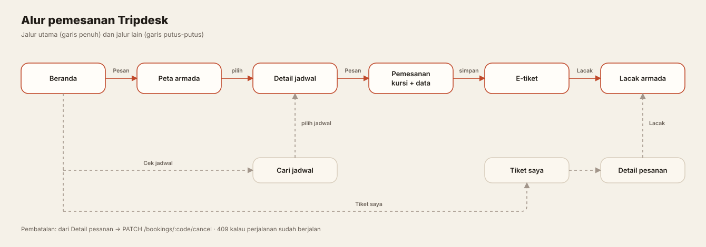
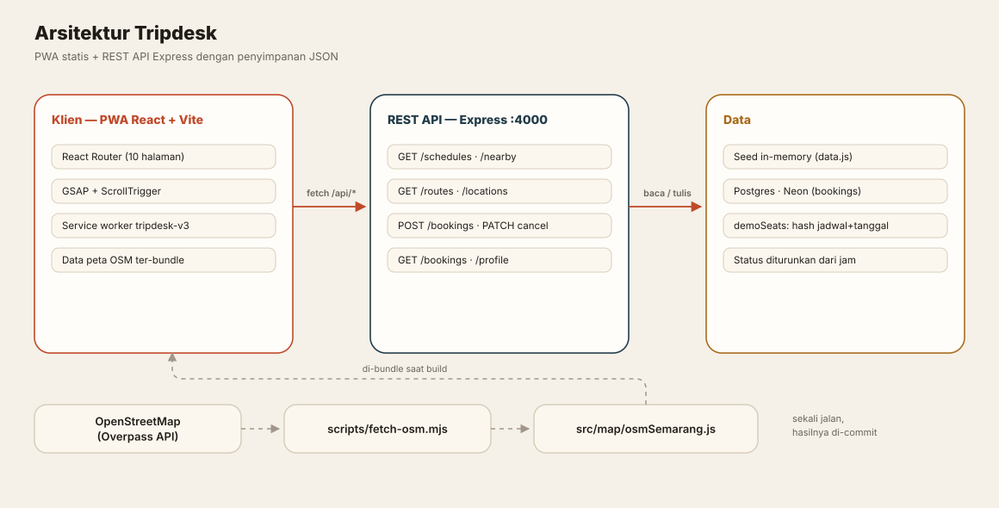

# Dokumentasi Tripdesk

Aplikasi pemesanan tiket **travel shuttle antarkota**: cari jadwal, pilih titik jemput, pilih kursi, terbit e-tiket, lacak armada (demo), dan batalkan pesanan.

- Frontend: React 18 + Vite (PWA), React Router 6, GSAP 3
- Backend: Express 4, REST API, penyimpanan JSON
- Peta: geometri OpenStreetMap (ODbL), digambar sebagai SVG — bukan tile, bukan GPS

Dokumen ini menjelaskan cara aplikasi bekerja. Untuk rencana & backlog lihat [RENCANA.md](RENCANA.md). Sumber diagram: [diagram.drawio](diagram.drawio) (buka di [app.diagrams.net](https://app.diagrams.net)).

## 1. Alur pemesanan



1. **Beranda** memuat rute, jadwal hari ini, profil, dan tiket terjadwal. Tombol **Pesan** membuka peta armada.
2. **Peta armada** (`/armada`) menampilkan 4 armada di sekitar titik jemput + estimasi tiba. Pengguna memilih titik jemput & tujuan, lalu memilih armada.
3. **Detail jadwal** (`/jadwal/:id`) menampilkan jam, harga, armada, sisa kursi, dan titik jemput.
4. **Pemesanan** (`/pesan/:id`) memilih kursi (1–6) dan mengisi data penumpang → `POST /api/bookings`.
5. **E-tiket / detail pesanan** (`/pesanan/:code`) menampilkan kode, kursi, titik jemput, dan QR-ish kode.
6. **Lacak armada** (`/lacak/:code`) menampilkan posisi demo armada pada koridor rute.

Jalur lain (garis putus-putus): **Cari jadwal** (`/cari`) masuk ke detail jadwal tanpa lewat peta; **Tiket saya** (`/pesanan`) membuka detail pesanan; pembatalan lewat `PATCH /api/bookings/:code/cancel` (409 kalau perjalanan sudah berjalan).

## 2. Arsitektur



- **Klien** adalah SPA statis. Semua halaman memanggil REST API lewat `src/shared/api.js` (base URL `VITE_API_URL` atau `/api`). Data peta OSM sudah dibundel saat build, jadi peta tetap tampil tanpa jaringan.
- **API** menyajikan katalog (kota, titik jemput, rute, jadwal), pencarian terdekat, pesanan, dan profil.
- **Data**: katalog adalah seed in-memory di `server/src/data.js`; pesanan disimpan di `server/data/bookings.json` (runtime, tidak di-commit).
- **Pipeline peta**: `scripts/fetch-osm.mjs` menarik geometri dari Overpass sekali, menulis `src/map/osmSemarang.js`, dan hasilnya di-commit — build tidak pernah menembak jaringan.

## 3. Struktur folder

Satu folder per fitur; hanya hal lintas halaman yang masuk `shared/`.

```
app/src/
├── home/       Home.jsx                 beranda
├── armada/     ArmadaMap.jsx            peta armada + sheet pemesanan
├── map/        ZoomMap, TravelMap, mapTransition,
│               semarangMapData, javaMapData, osmSemarang
├── tracking/   Tracking, TrackingMap, trackingView
├── search/     Search.jsx
├── schedule/   ScheduleDetail, ScheduleCard
├── checkout/   Checkout.jsx
├── orders/     Orders, OrderDetail, StatusPill
├── profile/    Profile.jsx
├── about/      About.jsx
├── shared/     api, utils, animations, weather, Icons, State,
│               BottomNav, NotFound
├── App.jsx     routing
├── main.jsx    bootstrap + registrasi service worker
└── styles.css  design system + layout mobile
```

Mau mengubah apa | Buka
--- | ---
Tampilan beranda | `home/Home.jsx`
Peta & kartu peta | `map/TravelMap.jsx`, `map/ZoomMap.jsx`
Sheet armada, titik jemput | `armada/ArmadaMap.jsx`
Halaman lacak | `tracking/Tracking.jsx` + `tracking/TrackingMap.jsx`
Alur kursi & data penumpang | `checkout/Checkout.jsx`
Warna, tipografi, jarak | `styles.css`

## 4. Halaman & rute

| Rute | Komponen | Data yang diambil | Catatan |
| --- | --- | --- | --- |
| `/` | `home/Home` | locations, routes, schedules, profile, bookings (`status=terjadwal`) | Peta kartu, grid layanan, rute favorit |
| `/armada` | `armada/ArmadaMap` | locations, pickup-points, nearby | Pilihan titik jemput/tujuan, 4 armada, ETA |
| `/cari` | `search/Search` | locations, pickup-points, schedules | Filter asal/tujuan/tanggal/titik jemput |
| `/jadwal/:id` | `schedule/ScheduleDetail` | schedule | Harga, armada, sisa kursi |
| `/pesan/:id` | `checkout/Checkout` | schedule, profile | Pilih kursi 1–6, `POST /bookings` |
| `/pesanan` | `orders/Orders` | bookings | Filter status + tombol "Hapus riwayat" (bulk) |
| `/pesanan/:code` | `orders/OrderDetail` | booking | E-tiket, tombol batal, hapus dari riwayat |
| `/lacak/:code` | `tracking/Tracking` | booking | Peta koridor + timeline perjalanan |
| `/profil` | `profile/Profile` | profile | Ringkasan akun |
| `/tentang` | `about/About` | — | Statis |
| `*` | `shared/NotFound` | — | Halaman tidak ditemukan |

## 5. REST API

Base: `http://localhost:4000/api`. Respons sukses `{ "data": … }`, gagal `{ "error": { "code": "…", "message": "…" } }`.

| Method | Path | Query / body | Keterangan |
| --- | --- | --- | --- |
| GET | `/health` | — | Cek hidup |
| GET | `/locations` | — | Kota asal/tujuan |
| GET | `/pickup-points` | `origin` | Titik jemput + `offsetMinutes` |
| GET | `/routes` | `origin`, `destination`, `date` | Daftar rute + jadwal ringkas |
| GET | `/routes/:id` | `date` | Satu rute |
| GET | `/schedules` | `origin`, `destination`, `date`, `pickupPointId` | Jadwal + sisa kursi |
| GET | `/schedules/:id` | `date` | Satu jadwal |
| GET | `/nearby` | `origin`, `destination`, `date`, `pickupPointId` | 4 armada terdekat + ETA/jarak demo |
| GET | `/bookings` | `status` | Daftar pesanan (status diturunkan dari jam) |
| GET | `/bookings/:code` | — | Satu pesanan |
| POST | `/bookings` | `scheduleId`, `date`, `seats[]`, `passenger{name,phone,email}`, `pickupPointId` | Buat pesanan → 201 |
| PATCH | `/bookings/:code/cancel` | — | Batalkan; 409 kalau perjalanan sudah mulai |
| DELETE | `/bookings/:code` | — | Hapus satu riwayat (hanya `selesai`/`dibatalkan`; 409 `TRIP_ACTIVE` kalau masih aktif) |
| DELETE | `/bookings` | — | Bersihkan semua riwayat (selesai + dibatalkan), pesanan aktif tetap |
| GET | `/profile` | — | Profil demo |

Kode error: `INVALID_ORIGIN`, `INVALID_SCHEDULE`, `SCHEDULE_NOT_FOUND`, `INVALID_DATE`, `INVALID_SEATS`, `SEAT_TAKEN`, `INVALID_NAME`, `INVALID_PHONE`, `INVALID_PICKUP`, `ROUTE_NOT_FOUND`, `BOOKING_NOT_FOUND`, `ALREADY_CANCELLED`, `TRIP_ACTIVE`, `TRIP_STARTED`, `NOT_FOUND`, `INTERNAL_ERROR`.

## 6. Model data

**Jadwal** (`data.js`): `id` (`smg-jpr-01`), `routeId`, `code`, `departTime`, `arriveTime`, `durationMinutes`, `price`, `origin/destination`, `distanceKm`, `fleet{model,plate}`, `seatLayout`, `amenities[]`, `pickupPoints[]`, `dropPoints[]`.

**Pesanan**: `code` (`TD-XXXXX`), `scheduleId`, `scheduleCode`, `date`, `origin`, `destination`, `departTime`, `arriveTime`, `seats[]`, `passenger{name,phone,email}`, `pickupPoint{id,name,time}`, `fleet`, `pricePerSeat`, `total`, `etaMinutes`, `status`, `createdAt`.

Jam jemput = jam berangkat − `pickupPoint.offsetMinutes`.

**Status.** Yang disimpan hanya `terjadwal` atau `dibatalkan`. Status perjalanan diturunkan dari jam sekarang (`server/src/bookingStatus.js`):

```
dibatalkan  → kalau tersimpan 'dibatalkan'
selesai     → sekarang >= tanggal + arriveTime
berlangsung → sekarang >= tanggal + departTime
terjadwal   → selain itu
```

**Riwayat.** Pesanan `selesai`/`dibatalkan` bisa dihapus satu-satu (`DELETE /bookings/:code`) atau sekaligus (`DELETE /bookings`). Pesanan aktif (`terjadwal`/`berlangsung`) sengaja dilindungi 409 `TRIP_ACTIVE` karena kursinya masih terpakai.

**Kursi.** Kursi "terjual" demo dibuat deterministik dari hash `scheduleId|date` (`demoSeats`) supaya tampilan konsisten tiap dibuka, lalu digabung dengan kursi pesanan nyata (`bookedSeats`). Satu pesanan maksimal 6 kursi; bentrok → 409 `SEAT_TAKEN`.

**Harga & ETA.** Harga per kursi dari seed; total = harga × jumlah kursi. ETA/jarak armada di `/nearby` adalah angka demo deterministik per titik jemput — bukan lalu lintas nyata.

## 7. Peta

Tiga lapisan zoom dalam **satu** `<svg>` (bukan ganti gambar): pulau Jawa → kota Semarang (14 km) → kampus 1,6 km (hanya Tembalang/`SMG-1`).

- **Sumber data.** `scripts/fetch-osm.mjs` menarik jalan, air, dan bangunan kampus dari Overpass (`https://overpass.openstreetmap.fr/api/interpreter`), memproyeksikan koordinat ke km relatif pusat Semarang, lalu menulis `src/map/osmSemarang.js` (~296 kB). Atribusi "© OpenStreetMap contributors" wajib tetap tampil (ODbL).
- **Kamera.** `ZoomMap` menganimasikan `viewBox`, bukan `transform`, supaya garis tetap tajam. Tinggi bingkai kota tetap 11,26 km; lebarnya mengikuti rasio panggung asli (`lebar/370`), sehingga area yang tampil sama dengan kartu Beranda pada lebar layar apa pun.
- **Transisi Beranda → /armada.** Kartu Beranda melebar dengan *clip reveal* (`clip-path` + `translateY`), bukan penskalaan, jadi isi peta tidak pernah diregangkan. Kartu memakai bingkai yang sama dengan panggung (skala 32,69 vs 32,86 px/km), sheet menu langsung duduk dan isinya memudar masuk, dan label/cincin radius ikut memudar supaya tidak "nongol" satu frame.
- **Lacak.** `TrackingMap` memakai jalan lokal OSM + koridor rute per titik jemput; mobil digerakkan `animateMotion` sepanjang koridor sesuai progres perjalanan.

Angka acuan (390×844, DPR 3, click pertama): frame rata-rata 8,4 ms (p95 9,1; maks 28,7), CLS 0,056, jeda sheet ~30 ms. Detail pengukuran ada di badan commit `8f83a19`.

## 8. PWA

- `public/manifest.webmanifest`: nama, ikon 192/512 + maskable + SVG, `display: standalone`, warna tema `#c0492b`.
- `public/sw.js` (cache `tripdesk-v3`): app shell di-precache saat install; navigasi **network-first** dengan fallback `index.html`; aset **cache-first**; request `/api/*` selalu ke jaringan. Service worker hanya didaftarkan saat produksi (`import.meta.env.PROD`).

## 9. Animasi & aksesibilitas

GSAP + ScrollTrigger untuk entrance halaman, reveal daftar, dan transisi peta. Semua animasi dibungkus `gsap.matchMedia('(prefers-reduced-motion: no-preference)')`; kalau pengguna meminta reduksi gerak, halaman langsung tampil di keadaan akhir.

Aturan praktis yang dipakai di repo ini:

- jangan animasikan `left/top/width/height` (33 ms/frame) — pakai `transform`, `clip-path`, atau `viewBox`;
- jangan pernah mengubah ukuran kotak yang memaksa raster ulang peta di tengah animasi;
- `ease: power1.out`/`power2.out` untuk kamera (hindari `inOut` yang membuat 150 ms awal terasa diam);
- elemen yang dihapus setelah animasi jangan memakai kelas global yang memicu ulang animasi masuk (lihat `.page.no-enter`).

## 10. Menjalankan & skrip

```bash
# API
cd server && npm install && npm run dev     # http://localhost:4000/api

# PWA
cd app && npm install && npm run dev        # http://localhost:5173 (proxy /api)
```

| Perintah | Fungsi |
| --- | --- |
| `npm run build` (app) | Build produksi ke `app/dist` |
| `npm run preview` (app) | Pratinjau hasil build di :4173 |
| `npm run test:tracking` (app) | 6 kasus status halaman lacak |
| `npm run test:status` (server) | 6 kasus turunan status pesanan |
| `node scripts/fetch-osm.mjs` (app) | Regenerasi data OSM (butuh internet) |

## 11. Deployment

Build frontend statis (Vite) dan API Express terpisah. Ada dua cara.

### A. Frontend di Vercel, API di host lain (disarankan)

1. Vercel → import repo → **Root Directory `app`**, framework Vite, build `npm run build`, output `dist`.
2. Env `VITE_API_URL=https://<host-api>/api` (dibaca saat build — ganti berarti redeploy).
3. API di Railway/Render/Fly/VPS: Root Directory `server`, start `npm start`, mount volume di `server/data` supaya pesanan tidak hilang saat restart.
4. `app/vercel.json` sudah menulis ulang semua path ke `index.html`, jadi deep link seperti `/pesanan/TD-XXXXX` tidak 404.

### B. Dua-duanya di Vercel (dua project)

1. **Project frontend**: Root Directory `app`, build `npm run build`, output `dist`, env `VITE_API_URL=https://<project-api>/api`.
2. **Project API**: Root Directory `server`. Tidak perlu konfigurasi build — Vercel mendeteksi Express dari `src/app.js` (default export) atau `src/index.js` (`app.listen`), lalu menjalankan seluruh app sebagai satu Vercel Function. Semua route, validasi, dan bentuk respons sama dengan versi lokal. `server/vercel.json` mengarahkan `/` ke `/api/health` supaya domain API bisa dicek langsung.
3. **Penyimpanan**: filesystem Vercel read-only, jadi `store.js` menulis ke `/tmp/tripdesk-data` saat env `VERCEL` ada. `POST /bookings` tetap 201, tetapi **data hilang saat instance baru/cold start**. Untuk data permanen, isi `TRIPDESK_DATA_DIR` ke disk persisten atau ganti store ke database.
4. CORS sudah terbuka (`app.use(cors())`); batasi `origin` kalau perlu.

Keduanya memakai Node 20+ (`server/package.json` → `engines`).

## 12. Batasan yang perlu diketahui

- Tidak ada autentikasi; satu profil demo (`USR-001`).
- ETA, jarak, cuaca, dan posisi armada adalah data demo deterministik, bukan GPS/lalu lintas nyata (dinyatakan di UI).
- Katalog bersifat seed in-memory; mengubah rute/jadwal berarti mengedit `server/src/data.js`.
- Peta hanya mencakup Semarang–Jepara/Kudus/Solo/Yogyakarta pada level provinsi; detail jalan hanya untuk Semarang.
- Bundle JS ~746 kB (249 kB gzip) karena data OSM ikut ter-bundel; layer kampus dipasang saat dibutuhkan.
